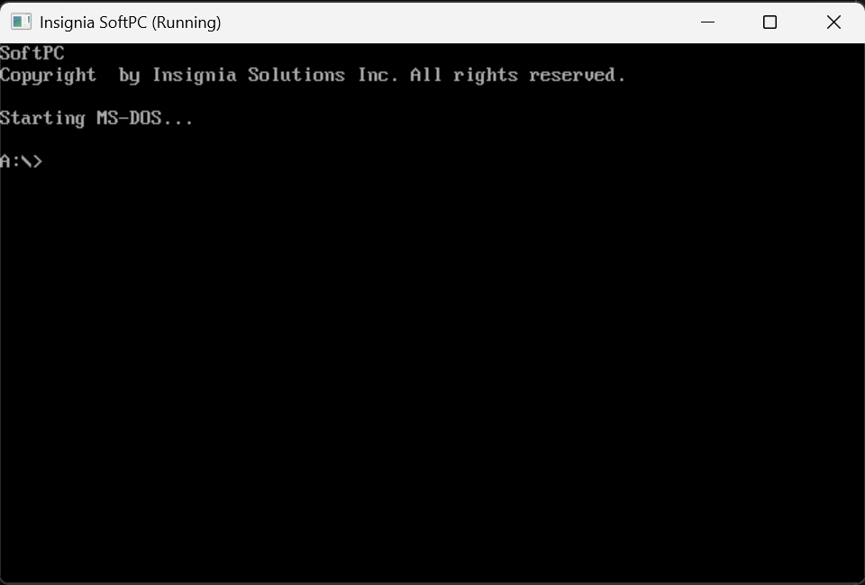
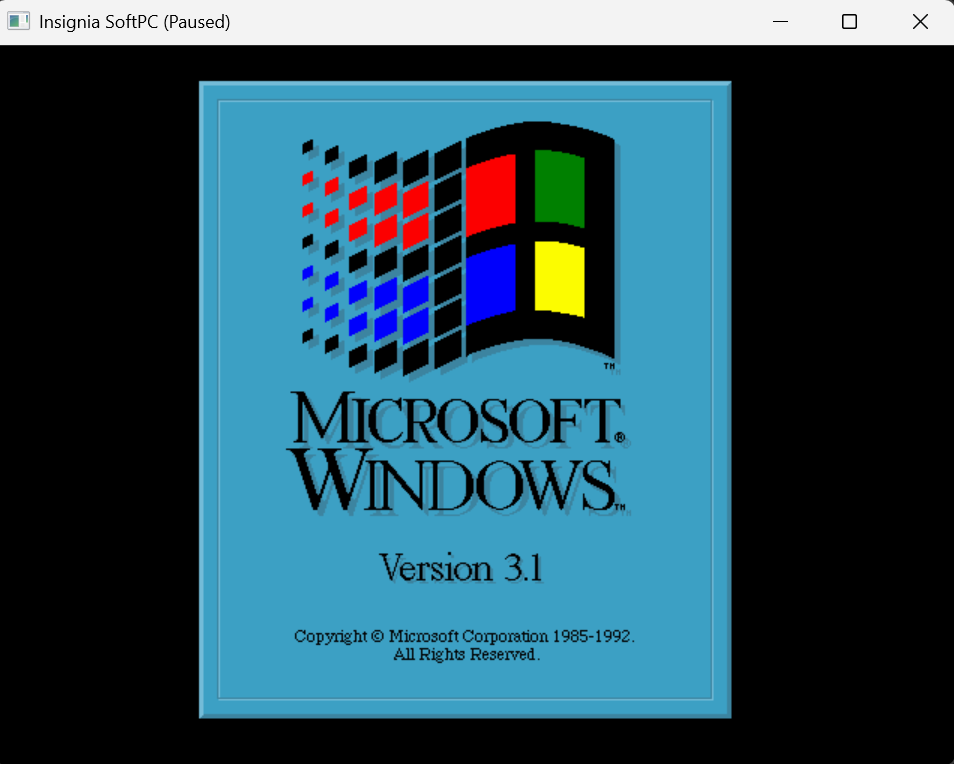
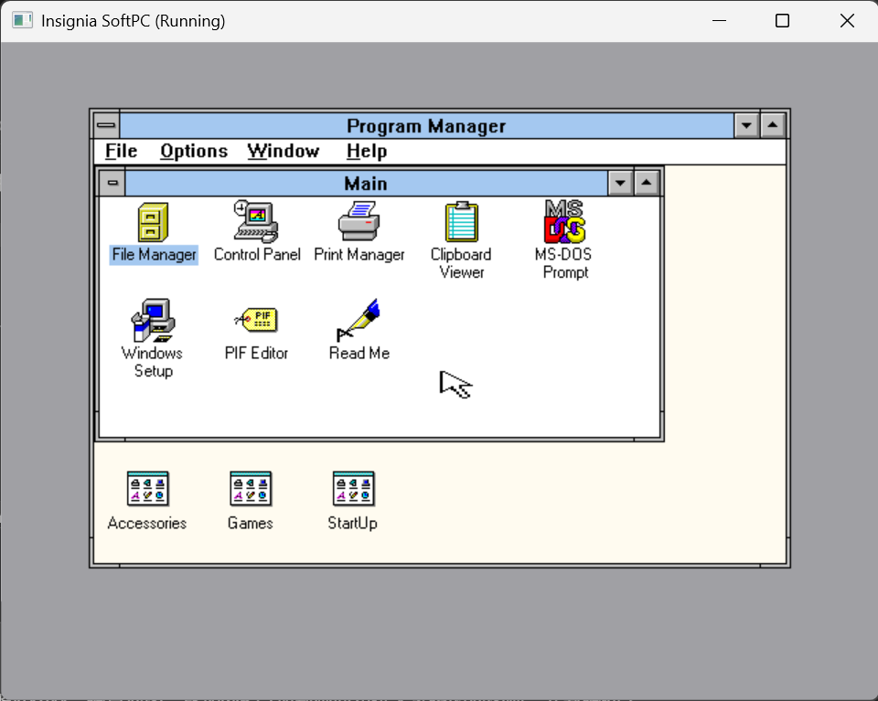

# Insignia SoftPC

A standalone PC emulator built from the recovered SoftPC source in Windows XP
SP1. It runs the original software CPU, BIOS and device logic with a small
compatibility host and shared runtime/UI components. It does not require an
NTVDM host process or hardware virtualization.

The current application targets **32-bit and 64-bit Windows**. It has been used
with MS-DOS, Windows 3.1 and Windows 95. There is one machine configuration;
users select memory, media and presentation rather than a machine model.

## In use

These existing captures show MS-DOS and Windows 3.1 running in SoftPC:







## Run

Clone the repository, then launch the checked-in package on Windows:

```bat
git clone https://github.com/cshaxu/softpc.git
cd softpc
assets\binary\softpc64.exe
```

Use `softpc32.exe` for the 32-bit package. Both executables load the
`softpc.ini` beside them and accept no command-line arguments. Relative media
paths in the INI are resolved from its directory.

At the monitor prompt, enter `start`. The checked-in configuration attaches the
bundled Windows 3.1 hard-disk image with `hard_disk_mode=overlay`, 16 MiB RAM,
and `display=console`. Text appears in the Console; graphics open a separate
window. Set `display=window` to use the window for both text and graphics.

### Monitor and input

Enter `help` for the command list. Common operations are:

| Command | Effect |
| --- | --- |
| `start` | Cold-start the machine. |
| `pause` / `resume` | Pause or continue guest execution. |
| `reset` | Reset the machine, leaving it paused. |
| `stop` | Stop the machine. |
| `save <file>` | Save a running or paused machine and leave it paused. |
| `load <file>` | Load a snapshot before starting or after stopping; then use `resume`. |
| `floppy insert <readonly\|direct\|overlay> <image>` | Insert drive A media while stopped or paused. |
| `floppy eject` | Eject drive A media while stopped or paused. |
| `debug` | Enter the x86 debugger; machine access requires paused state. |
| `exit` | Exit SoftPC. |

While interacting with the guest, `Ctrl+Alt+P` pauses/resumes and `Ctrl+Alt+M`
releases the captured mouse. `Ctrl+Alt+D`, `Ctrl+Alt+F` and `Ctrl+Alt+T` send
Ctrl+Alt+Del, Alt+Enter and Alt+Tab respectively to the guest. These are guest
view hotkeys, not cooked monitor commands. See [Product UI](docs/design/UI.md)
for state rules, debugger commands and window sizing behavior.

Snapshots use the current machine-state format; compatibility with snapshots
from older builds is not guaranteed. Keep the matching guest media available.

### Media and devices

`softpc.ini` selects memory, floppy/hard-disk images, independent attachment
modes, display and optional serial/printer output files. The floppy drive exists
even when no image is inserted. Boot order is A: then C:.

| Media mode | Guest writes |
| --- | --- |
| `readonly` | Rejected as write-protected. |
| `direct` | Written to the source image. |
| `overlay` | Kept in memory without modifying the source image; discarded when that medium is destroyed. |

The original device paths include PIC, PIT, DMA, floppy/fixed disk, keyboard,
Microsoft InPort mouse and CGA/EGA/VGA/Video7 presentation. Window rendering uses
the guest bitmap fonts and supports text underline, split cursors and graphics;
Console text uses a character mapping and cannot reproduce every scanline-level
effect. Both are presentation backends, not replacement video controllers.

Audio includes the PC speaker and Sound Blaster PCM playback through Lib Audio,
plus MPU-401 MIDI playback through the host MIDI output. WAV playback working
does not imply that the guest MIDI Mapper is configured. FM synthesis and the
Sound Blaster DSP MIDI route are not supported playback routes. For Windows 3.1,
see [MIDI configuration](docs/design/UI.md#windows-31-midi-playback), including
its mouse IRQ conflict and MIDI Mapper setup.

The original serial and printer controllers can write to files configured with
`serial_output` and `printer_output`; unset paths retain virtual endpoints.

## Build

Double-click [tools/Build.cmd](tools/Build.cmd) to build and publish **both**
`assets/binary/softpc32.exe` and `softpc64.exe`. The entry uses cmd.exe and CMake
presets, without PowerShell. Its window stays open to show the result.

The following tools must be available on the Windows PATH:

- CMake, Ninja and ccache;
- x64 MinGW GCC as `gcc`;
- x86 MinGW GCC as `i686-w64-mingw32-gcc`;
- the matching resource compiler and binutils for both toolchains.

Close running package executables before building. The script preserves the
adjacent INI, media and snapshots, and refreshes the embedded build timestamp.
A failure stops the script; the earlier architecture may already be published.
For automation:

```bat
tools\Build.cmd --no-pause
```

Exit code zero means both packages built successfully. **This does not run tests.**

For a direct cached build of one architecture:

```bat
cmake --preset ninja-ccache-gcc-x64-release
cmake --build --preset ninja-ccache-package-x64
```

Replace `x64` with `x86` for the other architecture. The corresponding plain
`ninja-gcc-*` / `ninja-package-*` presets are available without ccache.
[CMakePresets.json](CMakePresets.json) is the exact command/configuration source.

Reusable build trees are `build/.ninja/gcc-x86-release/` and
`build/.ninja/gcc-x64-release/`; compiler cache is `build/.ccache/` with a 5 GB
limit. Other build-directory content is disposable task output. See
[build hygiene](docs/rules/EXECUTION.md#changed-path-accounting-and-build-hygiene)
for cleanup ownership and the existing cleanup tool.

## Test

Build the test targets, then run the background suite for each architecture:

```bat
cmake --preset ninja-ccache-gcc-x64-release
cmake --build --preset ninja-ccache-tests-x64
ctest --preset ninja-ccache-test-x64
```

Again, replace `x64` with `x86` for the other package. These presets include
unit tests, repository gates and background integration tests, but **exclude
native desktop and audio tests**. To include the latter, keep an interactive
Windows desktop or RDP session connected with the required audio/MIDI devices
available, avoid competing keyboard/mouse input, and run separately:

```bat
ctest --test-dir build/.ninja/gcc-x64-release -L "desktop|native_audio" -j 1 --output-on-failure
ctest --test-dir build/.ninja/gcc-x86-release -L "desktop|native_audio" -j 1 --output-on-failure
```

A complete dual-architecture run requires both background suites and both native
suites. Native tests require their real host devices and session; the background
suite alone is not a complete integration run.

## Source and documentation

| Directory | Responsibility |
| --- | --- |
| `src/app-softpc/softpc.new/` | Preserved XP SP1 source subset and embedded firmware, with reviewed local differences. |
| `src/app-softpc/compat/` | Host callbacks, media/audio/video adaptation and original ABI support. |
| `src/app-softpc/machine/` | SoftPC driver, frame/input conversion, debugger and snapshot integration. |
| `src/app-softpc/product/` | Configuration, composition and product commands. |
| `src/lib/` | Shared platform mechanics, storage, input, PCM/MIDI and KVM presentation. |
| `src/emulator/` | Shared executor, session and product/UI composition. |
| `src/x86-debug/` | Shared x86 DEBUG and assembly/disassembly. |
| `src/x86-ibmpc/` | Shared PC commands, hotkeys and entry. |
| `test/` | Matching component unit tests and explicit integration suites. |
| `tools/` | Build entry and source, package and governance checks. |
| `assets/` | Published packages, guest media and README screenshots. |

Start at the [documentation guide](docs/README.md). The
[architecture](docs/design/ARCHITECTURE.md), [source layout](docs/design/CODING.md)
and [current task state](docs/states/CURRENT.md) own the detailed design and
status. Read [CONTRIBUTING.md](CONTRIBUTING.md) before changing the project.
